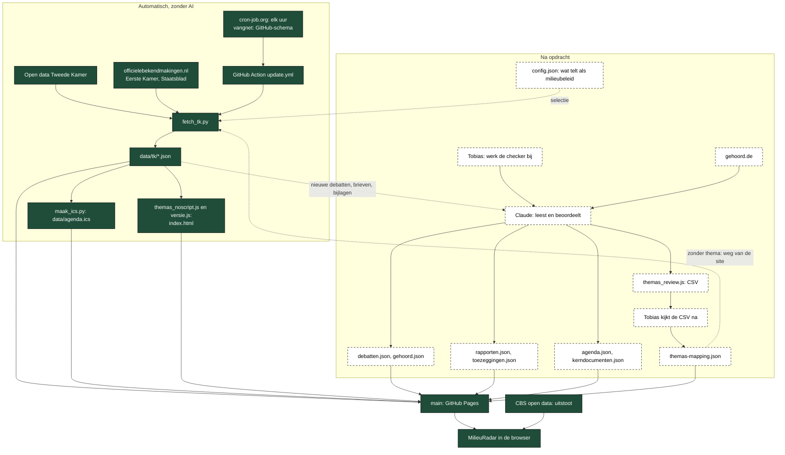

# MilieuRadar

Een overzicht van Nederlands milieu- en klimaatbeleid in de Tweede Kamer: de fase van wetsvoorstellen, moties en amendementen met de stemming per fractie, samenvattingen van debatten en de agenda.

**Website:** https://tobiasraucher.github.io/milieubeleid-checker/

Gestart met **Klimaat & energie** (focus: de Klimaatwet). Water & adaptatie, natuur/stikstof/landbouw en circulaire economie volgen.

## Hoe het werkt

| Onderdeel | Wie/wat | Bestanden |
|---|---|---|
| Wetsvoorstellen, moties, amendementen, stemmingen, activiteiten, Kamerbrieven en Kamervragen | Script, automatisch, zonder AI (Tweede Kamer open data) | `pipeline/fetch_tk.py` → `data/tk/` |
| Debatsamenvattingen (kort + gestructureerd) | Claude, op basis van transcripten van gehoord.de | `data/debatten.json` |
| Mijlpalen en deadlines | Claude | `data/agenda.json` |
| Website | Statische pagina, geen build-stap | `index.html`, `assets/` |

## Schema

Groen met een doorgetrokken lijn gaat automatisch; wit met een stippellijn gebeurt pas na een opdracht van Tobias.

## Bijwerken

- **Kamerdata (gratis, geen AI):** GitHub → tabblad *Actions* → *Data bijwerken (Tweede Kamer open data)* → *Run workflow*. De Action draait op werkdagen elk uur van 8 tot 19 (cron-job.org), met als vangnet het GitHub-schema van 05:17 en 17:17 UTC (`schedule` in `.github/workflows/update.yml`).
- **Samenvattingen en mijlpalen:** vraag Claude in het project "Checker Dutch Government Environmental Policy": *"Werk de checker bij"*. Claude haalt de nieuwste data op, vat nieuwe debatten samen en pusht naar deze repo. De werkwijze staat in `CLAUDE.md`.

## Uitbreiden naar een nieuwe sector

Zet in `pipeline/config.json` de sector op `"actief": true` en vul `commissies`, `kamerstukdossiers` en `zoektermen` in.

## Kanttekeningen

- Transcripten van gehoord.de zijn automatisch en niet door mensen gecorrigeerd. Samenvattingen zijn een hulpmiddel, geen officiële bron: citeer de Handelingen.
- Uitslagen en stemmen komen rechtstreeks uit de open data van de Tweede Kamer.
- De Eerste Kamer heeft geen vergelijkbare open data; EK-stappen worden handmatig bijgehouden als mijlpalen in `data/agenda.json`.
